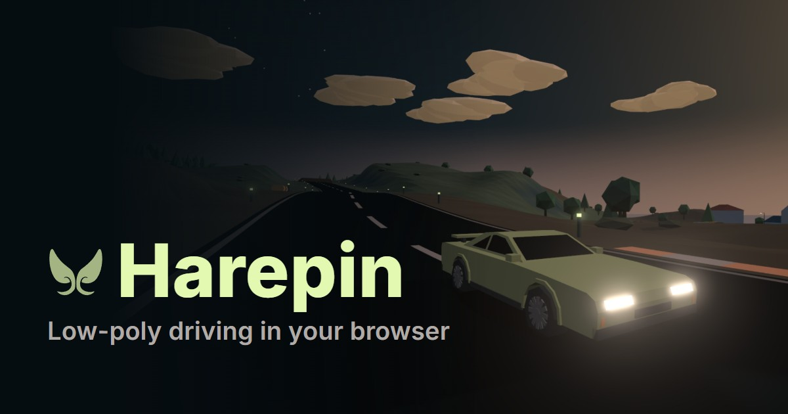

<a href="https://lilbunnyrabbit.github.io/harepin/"></a>

<h2 align="center"><a href="https://lilbunnyrabbit.github.io/harepin/">Play Harepin</a></h2>
<p align="center">Free, in the browser, nothing to install.</p>

# Harepin

A small low-poly driving game. Pick a car, drive an island at dusk, then take the track in the sky.

- **Two worlds.** An island with a road loop, villages, mountain hairpins and open ground to roam. Above it, a track of rails and decks in the sky.
- **Modes.** Race, Ghost duel, Gymkhana, Drift zones, Gate hunt and Parking, with levels and stars. Your best lap drives beside you as a ghost.
- **Garage.** Body, paint and parts: engine, tyres, suspension, brakes. Save builds and see what each part changes against stock.
- **Friends a link away.** Copy the invite link and whoever opens it lands in your room, on your map. No account, no server. Race, chat, see each other's cars.
- **Any device.** Keyboard, gamepad, or touch on a phone or tablet held sideways. Install it as an app (PWA) and it runs offline.

## Why the name

Hare plus hairpin. The hare is the lilBunnyRabbit bunny, the ears in the logo. The hairpin is the tight 180° bend, the corner every driving game gets judged by.

## How online works

There is no game server.

- **Finding players.** Trystero posts tiny signalling messages to public Nostr relays (5 of them, picked from the app id). Tabs in the same browser also talk over BroadcastChannel.
- **Connecting.** Cars talk peer to peer over WebRTC. ICE always tries a direct path first: the local network, then your public address through STUN (Google and Cloudflare, trystero's defaults). A TURN relay (Metered free tier, `src/net/ice.ts`, added through trystero's `turnConfig`) is only used when no direct path works. That usually means a phone on mobile data behind carrier NAT. It is a fallback: if TURN is down or the free quota runs out, players who can connect directly play as before.
- **Credentials.** The TURN login comes in at build time from the GitHub Actions secrets `TURN_USERNAME` / `TURN_CREDENTIAL` (locally from `.env.local`, which git ignores). It is only lightly obfuscated in the bundle and is not a secret, because browsers need it. If it gets abused, rotate it in the Metered dashboard. A build without it uses STUN only.
- **Game data.** Each client owns its car and sends a binary packet of about 80 bytes 20 times a second (`src/net/car-packet.ts`). Peers on another protocol version are told to update.

## Develop

```sh
bun install
bun run dev                # http://localhost:5173
bun run typecheck
bun test
bun run telemetry          # 0-100, top speed, braking, skidpad
bun scripts/feel.ts        # handling scenarios: step steer, lift-off, power-on, handbrake, trail brake, slopes
bun scripts/autolap.ts     # autopilot lap of the island road
bun run build              # static dist/
```

`AGENTS.md` has the folder map, registries and code rules.

URL params: `?room=friends` (default `lobby`), `?name=Ana`, `?world=sky`, `?seed=…`, `?theme=Brand%20Light`, `?quality=low` (no bloom, 1x pixel ratio). Quality also steps down on its own when frames run under 45 fps.

Default controls (rebindable in Settings): WASD/arrows, Space handbrake, Backspace rewind, R reset, L restart lap, C camera, F recenter, G best-lap ghost, V garage, H key list, Q/E shift, M auto gearbox, 1/2/3 toggle TCS/ABS/assist, T chat, Esc menu. Gamepad: RT/LT, stick, A handbrake, X rewind, Y reset, LB/RB shift.

## Hosting

Static site on GitHub Pages: `.github/workflows/deploy.yml` builds on every push to `master` with the TURN secrets in the environment. Any static host works with the same `bun run build` and `dist/`.

Peer data is untrusted: `net.ts` takes the sender id from the WebRTC peer, shape-checks and clamps every field, and rate-limits each peer.

## How it's built

- `src/car/car.ts`: the sim. Rigid body at 360 Hz, raycast suspension and anti-roll bars, normalised Pacejka tyres with combined slip, semi-implicit wheel spin, torque curve, gearbox, RWD/FWD/AWD per car, ABS, TCS, and an assist mode: speed-sensitive grip-limited steering lock, countersteer past 6° of slide, and a yaw damper that only fights yaw growing a slide.
- `src/worldgen/`: pure world generation in a Web Worker: island heightfield and road, sky track rails. `src/world/` answers height, grip and collision queries at runtime.
- `src/render/`: scene, dusk/day sky and clouds, effects, quality tiers, and a chase camera that leads into slides, pulls back under acceleration and shakes off-road and on impacts.
- `src/net/`: trystero rooms, the binary car packet, lobby, chat and the room directory. Remotes are drawn slightly behind and interpolated. Cars are ghosts to each other.
- `src/theme/`: the webos theme presets, applied as the same CSS custom properties webos uses. The HUD styles from them and the 3D scene reads each resolved token back. Dark themes drive at dusk, light themes in daytime.
- `src/car/ghost.ts`: records each lap and replays your best one as a translucent car.

## Why no physics engine

Feel lives in the tyre/drivetrain/assist layer, which no web engine provides; their vehicle controllers would be replaced anyway. What remains (one rigid body, 4 raycasts on a heightfield) is small, runs headless in Bun for the scenario scripts, and keeps the bundle free of a 1-3 MB WASM engine. Switch the chassis and collisions to Rapier once the world needs mesh colliders or car-to-car contact; the tyre code stays and just feeds it forces.

## Known limits

- P2P can't stop cheating; lap times are client-reported.
- Cars pass through each other.
